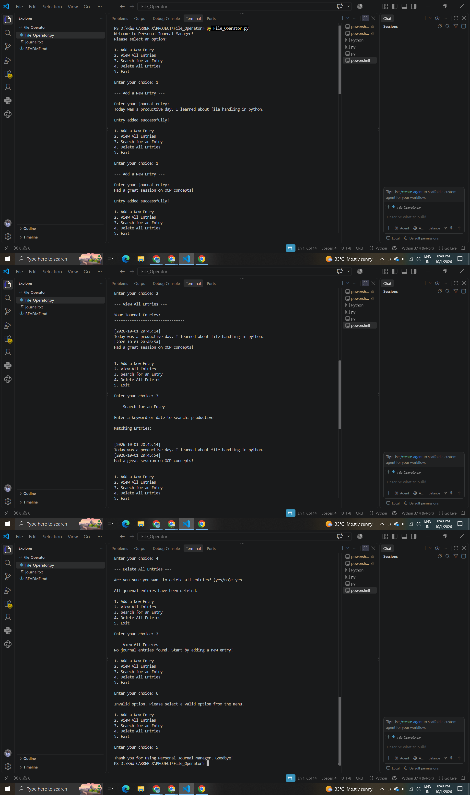

# Python File Handling Project: Personal Journal Manager

**Author:** Meera Kyada

---

## 📌 Project Overview

The **Personal Journal Manager** is a Python-based project developed to demonstrate the practical use of File Handling in Python. The project demonstrates reading, writing, and appending data in a text file along with functions, exception handling, date and time handling, and a menu-driven interface.

The system allows users to add new journal entries, view all saved entries, search for an entry using a keyword or date, and delete all journal entries through a simple interactive menu-driven interface.

---

## 🎯 Project Objectives

The main objectives of this project are:

- To understand the basic concepts of File Handling in Python.
- To create and store journal entries in a text file.
- To read and display stored information from a file.
- To search for journal entries using a keyword or date.
- To delete all stored journal entries.
- To understand different file opening modes.
- To use functions for organizing program operations.
- To handle missing files using exception handling.
- To create an interactive menu-driven Python application.

---

## 🛠️ Technologies Used

- **Programming Language:** Python
- **Python Version:** 3.14.6
- **Programming Concept:** File Handling
- **Module Used:** `datetime`
- **Development Environment:** Visual Studio Code

---

## 📁 Project Structure

```text
File_Operator/
│
├── File_Operator.py
├── journal.txt
├── output.png
└── README.md
```

### File Description

- **File_Operator.py** – Main Python program containing the journal management logic.
- **journal.txt** – Text file used to store journal entries.
- **output.png** – Screenshot of the program output.
- **README.md** – Project documentation.

---

## ✨ System Features

The system provides the following features:

- Add a New Entry
- View All Entries
- Search for an Entry
- Delete All Entries
- Exit the program
- Automatically record the date and time of each entry
- Store journal entries in a text file
- Handle missing journal files
- Interactive menu-driven interface

---

## 📂 Main Functions

The project contains four main functions:

1. **`add_entry()`**
2. **`view_entries()`**
3. **`search_entry()`**
4. **`delete_entries()`**

Each function performs a specific operation related to journal management.

---

## ➕ Add a New Entry

The `add_entry()` function is used to create and save a new journal entry.

The function:

- Asks the user to enter a journal entry.
- Gets the current date and time.
- Opens `journal.txt` in append mode.
- Writes the date and time.
- Writes the journal entry.
- Closes the file.
- Displays a success message.

### File Mode Used

```python
file = open(file_name, "a")
```

The `"a"` mode is used so that new entries are added without removing existing entries.

### Date and Time

The program uses the `datetime` module:

```python
date = datetime.now().strftime("%Y-%m-%d %H:%M:%S")
```

This records the current date and time for every new entry.

---

## 👀 View All Entries

The `view_entries()` function is used to display all saved journal entries.

The function:

- Opens the journal file in read mode.
- Reads the complete file content.
- Checks whether the file contains any data.
- Displays all journal entries if data is available.
- Displays a message if no entries are found.
- Handles the case where the file does not exist.

### File Mode Used

```python
file = open(file_name, "r")
```

The `"r"` mode is used to read the contents of the file.

---

## 🔍 Search for an Entry

The `search_entry()` function allows the user to search for an entry using a keyword or date.

The user enters a keyword or date, and the program checks whether it is present in the journal data.

The search is case-insensitive using:

```python
keyword.lower() in data.lower()
```

If a matching keyword is found, the journal data is displayed.

If no match is found, the program displays an appropriate message.

---

## 🗑️ Delete All Entries

The `delete_entries()` function is used to delete all stored journal entries.

Before deleting the entries, the program asks the user for confirmation:

```text
Are you sure you want to delete all entries? (yes/no):
```

If the user enters `yes`, the file is opened in write mode:

```python
file = open(file_name, "w")
file.close()
```

Opening the file in `"w"` mode clears its existing contents.

If the user enters anything other than `yes`, the delete operation is cancelled.

---

## 📚 File Handling Concepts

This project demonstrates three important file opening modes.

### 1. Append Mode – `"a"`

Used to add new journal entries without removing existing data.

```python
open(file_name, "a")
```

### 2. Read Mode – `"r"`

Used to read existing journal entries.

```python
open(file_name, "r")
```

### 3. Write Mode – `"w"`

Used to clear all existing journal entries.

```python
open(file_name, "w")
```

---

## ⚠️ Exception Handling

The program uses `try-except` to handle situations where the journal file does not exist.

The following exception is handled:

```python
except FileNotFoundError:
```

For example, if the user tries to view or search entries before the journal file has been created, the program displays an appropriate message instead of stopping unexpectedly.

---

## 🧩 Functions Used

Functions are used to divide the program into separate operations.

| Function | Purpose |
|---|---|
| `add_entry()` | Adds a new journal entry |
| `view_entries()` | Displays all journal entries |
| `search_entry()` | Searches for an entry |
| `delete_entries()` | Deletes all journal entries |

Using separate functions makes the program easier to understand and organize.

---

## 🖥️ Interactive Menu System

The program provides a simple menu-driven interface.

```text
1. Add a New Entry
2. View All Entries
3. Search for an Entry
4. Delete All Entries
5. Exit
```

The user can select an option and perform the required operation.

---

## 🔄 Program Workflow

The basic workflow of the system is:

```text
Start
  ↓
Display Welcome Message
  ↓
Display Main Menu
  ↓
Select Operation
  ↓
Add / View / Search / Delete
  ↓
Perform Selected Operation
  ↓
Return to Main Menu
  ↓
Continue or Exit
```

---

## 🧪 Input Handling

The program accepts different types of information from the user:

- Journal Entry
- Search Keyword or Date
- Delete Confirmation
- Menu Selection

The `input()` function is used to collect information from the user.

Example:

```python
entry = input("\nEnter your journal entry:\n")
```

---

## 🕒 Date and Time Handling

The project uses Python's `datetime` module to record the date and time when a journal entry is created.

```python
from datetime import datetime
```

The current date and time are formatted as:

```text
YYYY-MM-DD HH:MM:SS
```

Example:

```text
[2026-10-01 15:30:45]
Today I learned Python file handling.
```

---

## 📊 File Handling Concepts Demonstrated

| Concept | Used In Project |
|---|---|
| File Handling | Reading and writing journal data |
| Append Mode | Adding new entries |
| Read Mode | Viewing and searching entries |
| Write Mode | Deleting all entries |
| Functions | Organizing program operations |
| `datetime` | Recording date and time |
| Exception Handling | Handling missing files |
| `FileNotFoundError` | Detecting unavailable journal file |
| User Input | Getting information from the user |
| String Methods | Case-insensitive searching |
| Menu-Driven Program | Providing user operations |

---

## ▶️ How to Run

### Step 1: Install Python

Make sure Python is installed on your system.

Check the installed version:

```bash
python --version
```

### Step 2: Open the Project

Open the project folder in Visual Studio Code.

### Step 3: Run the Program

Open the terminal and run:

```bash
python File_Operator.py
```

### Step 4: Use the Menu

Select the required option and enter the requested information.

---

## 📝 Assumptions

- The program is designed for learning and demonstration purposes.
- Journal entries are stored in a text file.
- The journal file is named `journal.txt`.
- Entries are stored in the local text file.
- The delete option removes all existing journal entries after confirmation.
- The program runs through a command-line interface.

---

## 🎓 Learning Outcomes

This project helps in understanding:

- Python file handling
- Reading and writing text files
- Different file opening modes
- Creating and using functions
- Exception handling
- Handling `FileNotFoundError`
- Working with date and time
- Searching text data
- Building menu-driven applications
- Taking and processing user input

---

## 🚀 Future Enhancements

The project can be enhanced in the future by adding:

- Edit an existing journal entry
- Delete a specific journal entry
- Search and display only matching entries
- Password protection
- Multiple journal files
- Graphical User Interface (GUI)
- Database storage
- Export journal entries to PDF
- Category or mood-based journal entries

---

## 🖥️ Output Presentation

The following screenshot shows the output of the Personal Journal Manager.



---

# 💻 Sample Output

The program displays an interactive menu where users can add, view, search, and delete journal entries.

Example:

```text
Welcome to Personal Journal Manager!
Please select an option:

1. Add a New Entry
2. View All Entries
3. Search for an Entry
4. Delete All Entries
5. Exit
```

### Add a New Entry

```text
--- Add a New Entry ---

Enter your journal entry:
Today I learned Python file handling.

Entry added successfully!
```

### View All Entries

```text
--- View All Entries ---

Your Journal Entries:
--------------------------------
[2026-10-01 15:30:45]
Today I learned Python file handling.
```

### Search for an Entry

```text
--- Search for an Entry ---

Enter a keyword or date to search: Python

Matching Entries:
--------------------------------
[2026-10-01 15:30:45]
Today I learned Python file handling.
```

### Delete All Entries

```text
--- Delete All Entries ---

Are you sure you want to delete all entries? (yes/no): yes

All journal entries have been deleted.
```

### Exit

```text
Thank you for using Personal Journal Manager. Goodbye!
```

The complete output screenshot is available in `output.png`.

---

## 📌 Conclusion

The **Personal Journal Manager** is a Python-based project that demonstrates the practical use of File Handling concepts.

The project provides a clear understanding of reading, writing, and appending data in a text file. It also demonstrates functions, different file modes, date and time handling, user input, searching, and exception handling.

This project shows how Python File Handling concepts can be combined to create a simple and interactive journal management application.

---

## 🙏 Thank You

Thank you for reviewing this project.